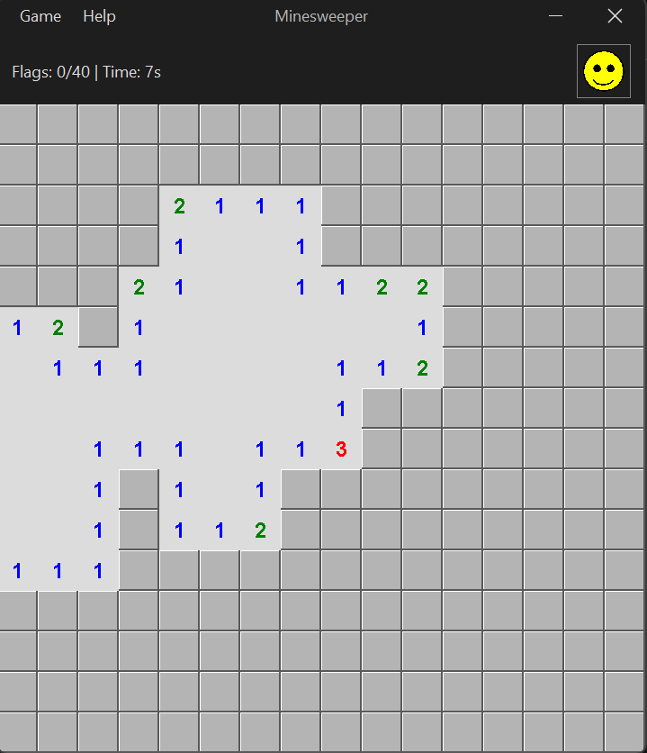

# Buscaminas

Versión moderna del clásico Buscaminas, desarrollada en Java con interfaz Swing y un elegante tema oscuro gracias a FlatLaf.

## Características

- **Interfaz moderna** con tema oscuro (FlatMacDarkLaf).
- **Tres niveles de dificultad:** Principiante (8x8, 10 minas), Intermedio (16x16, 40 minas) y Experto (16x30, 99 minas).
- **Cronómetro** que arranca con el primer clic.
- **Banderas** con clic derecho y contador de las colocadas.
- **Primer clic seguro:** las minas se colocan después, evitando la casilla pulsada.
- **Carita indicadora** del estado de la partida: normal, victoria (con gafas de sol) y derrota (ojos en X).
- Minas, banderas y números dibujados con gráficos vectoriales.
- Diálogo *Acerca de* con la información de la aplicación.

## Requisitos

- JDK 21 y Maven 3.9 o superior.

## Compilar y ejecutar

```bash
mvn clean package
java -jar target/mvn-minesweeper-1.0.0-launcher.jar

# o directamente con Maven
mvn clean compile exec:java
```



## Cómo jugar

1. **Empieza:** haz clic en cualquier casilla.
2. **Descubre casillas:** clic izquierdo.
3. **Marca minas:** clic derecho para poner o quitar una bandera.
4. **Objetivo:** descubrir todas las casillas que no tienen mina.
5. **Victoria:** todas las casillas sin mina están descubiertas.
6. **Derrota:** descubres una casilla con mina.

### Reglas

- Los números indican cuántas minas hay en las casillas contiguas (8 direcciones).
- Las casillas vacías (sin número) se descubren en cascada.
- El contador de banderas muestra las banderas colocadas respecto al total de minas.

### Colores de los números

| Número | Color |
|:------:|-------|
| 1 | Azul |
| 2 | Verde |
| 3 | Rojo |
| 4 | Azul oscuro |
| 5 | Marrón |
| 6 | Cian |
| 7 | Negro |
| 8 | Gris |

## Detalles técnicos

- **Arquitectura:** separación entre la lógica del juego, la interfaz y los eventos.
- **Componentes propios:** cada casilla es un `JPanel` (`CellPanel`) que se dibuja a sí mismo.
- **Eventos:** `MouseAdapter` distingue el clic izquierdo del derecho.
- **Cronómetro:** `javax.swing.Timer`.
- **`MinesweeperFrame`:** generación aleatoria de minas, descubrimiento recursivo de casillas vacías y detección de victoria o derrota.
- **`SmileyIcon`:** carita dibujada con Java 2D y antialiasing, con tres estados.

## Solución de problemas

- **El juego no arranca:** comprueba que tienes Java 21 o superior con `java -version`.
- **Error al compilar:** comprueba Maven con `mvn -version` y limpia el proyecto con `mvn clean`.

## Estructura

```text
src/main/java/com/juniverse/game/
├── Main.java
├── model/
│   └── MineField.java         # reglas del juego (minas, banderas, victoria y derrota), sin interfaz
├── gui/
│   ├── MinesweeperFrame.java  # ventana: dibuja las casillas y atiende el ratón
│   ├── CellPanel.java         # casilla del tablero
│   ├── SmileyIcon.java        # carita del estado
│   └── AboutDialog.java
└── util/                      # fechas, iconos y mensajes
```

## Pruebas

```bash
mvn test
```

Las reglas están separadas de la ventana en `MineField`, por eso se prueban sin abrir ninguna interfaz gráfica.

## Licencia

Código de ejemplo de uso libre con fines educativos.
